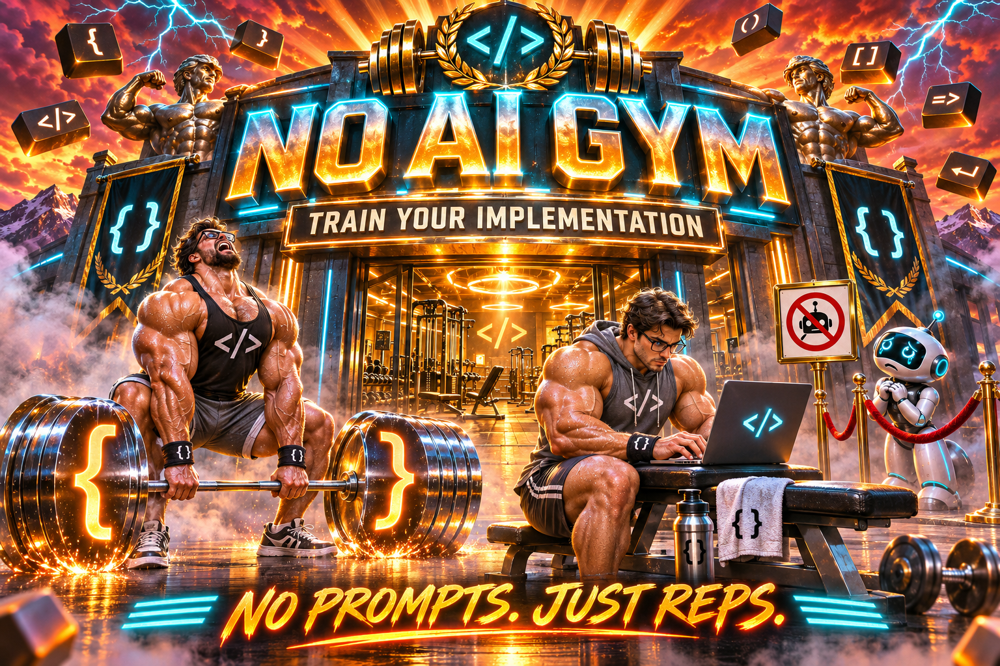
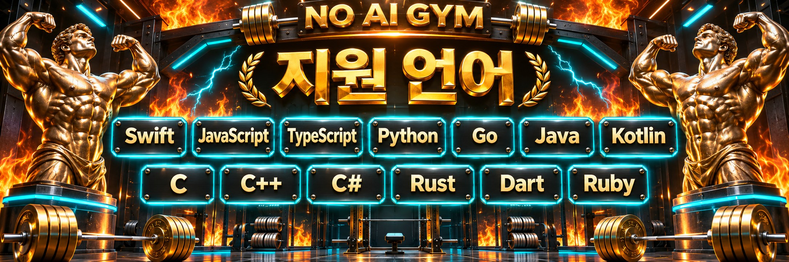

<div align="center">
  

  <br />
  <br />

  

  <br />
  <br />

  

  <br />
  <br />

  

</div>

## 사용 방법

연습하고 싶은 코드에 `gym add 파일명`을 실행하세요. 구현 본문을 비운 사본을 저장해 두고, 나중에 직접 채우는 도구입니다.

### 1. 내 레포 만들기

1. [템플릿으로 레포 만들기](https://github.com/no-ai-gym/gym-template/generate)를 엽니다.
2. **Owner**에 no-ai-gym, **Repository name**에 원하는 이름을 입력합니다.
3. **Create repository**를 누릅니다.
4. 만든 레포에서 **Code → HTTPS** 주소를 복사합니다.

터미널에서 아래 명령을 실행합니다. `내-레포-주소`와 `내-레포-이름`은 본인의 값으로 바꿔주세요.

```bash
git clone 내-레포-주소
cd 내-레포-이름
```

### 2. 설치하기

macOS 터미널 기준입니다. 먼저 Python 버전을 확인하세요.

```bash
python3 --version
```

**3.10 이상**이면 다음으로 진행합니다. Python이 없거나 버전이 낮다면 [Python 설치 페이지](https://www.python.org/downloads/macos/)에서 설치한 뒤 터미널을 다시 여세요.

방금 clone한 레포 폴더에서 실행합니다.

```bash
bash scripts/install.sh
export PATH="$HOME/.local/bin:$PATH"
gym status
```

`gym status`에 본인 gym 레포 경로가 나오면 설치가 끝났습니다. 설치는 처음 한 번만 하면 됩니다.

새 터미널에서도 `gym`을 쓰려면 `~/.zshrc` 파일에 다음 줄을 한 번 추가하세요.

```bash
export PATH="$HOME/.local/bin:$PATH"
```

### 3. 연습할 코드 가져오기

**원래 작업하던 프로젝트**에서, 가져올 파일이 있는 폴더의 터미널을 엽니다.

```bash
gym add 파일명
```

파일명을 연습하고 싶은 코드의 이름으로 바꾸세요. 원본은 그대로 두고, 개인 gym의 `workouts/`에 연습용 사본을 저장합니다.

파일의 **모든 구현 본문**이 `GYM TODO`로 바뀝니다. 각 함수·메서드의 시그니처와 본문 밖 코드는 유지됩니다. 본문 안에 중첩된 코드는 바깥 본문과 함께 비워집니다.

현재 폴더와 하위 폴더의 코드 파일을 각각 가져오려면:

```bash
gym add .
```

### 4. 직접 구현하기

1. 편집기에서 **개인 gym 레포**를 엽니다.
2. `workouts/`에서 연습할 코드의 폴더를 엽니다.
3. 원래 파일명으로 저장된 코드 파일에서 `GYM TODO`를 찾아 직접 구현합니다.
4. 막히면 같은 폴더의 `Original.<확장자>.txt`를 열어 원본과 비교합니다.

실행 결과를 확인하려면 해당 언어의 실행 환경과 원본에서 사용한 의존성이 필요합니다. Gym은 연습 파일을 준비하며 자동 채점은 하지 않습니다.
